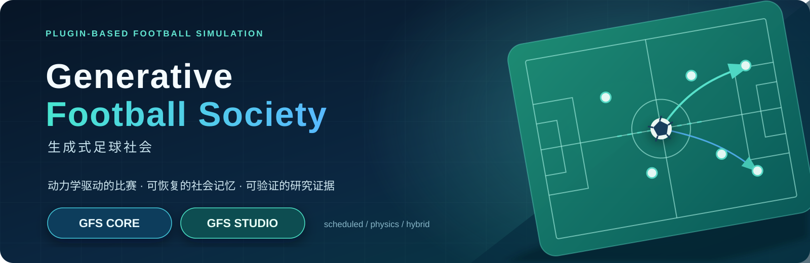
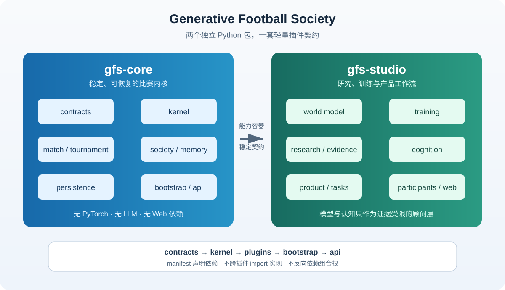
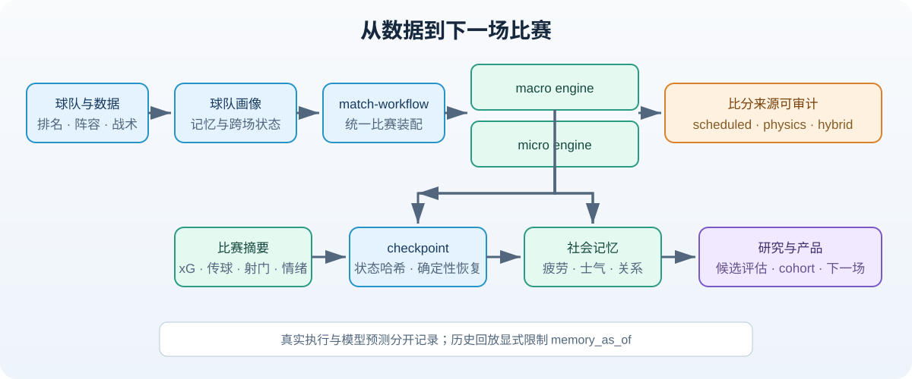

一个可插拔、可恢复的足球社会仿真平台。项目分为两个独立 Python 包：`gfs-core` 负责比赛与锦标赛，`gfs-studio` 负责世界模型、研究证据、训练和产品工作流。

**先运行一场真实微观比赛，再理解插件。不要把“代码能运行”误认为“足球或社会结论已经得到验证”。**

## 项目结构



| 项目 | 负责什么 | 不包含什么 |
|---|---|---|
| [`gfs-core`](gfs-core/) | 球队数据、宏观/微观比赛、锦标赛、情绪与记忆、checkpoint、跨场状态 | 不依赖 PyTorch、LLM 或 Web 框架 |
| [`gfs-studio`](gfs-studio/) | 世界模型、训练数据、模型评估、研究证据、经理候选、参与者与 loopback Web | 不复制 Core 的比赛内核 |

两个项目共享 `contracts → kernel → plugins → bootstrap → api` 分层和插件生命周期，但可以分别安装、测试和构建。

## 快速开始

### 环境要求

- Python `3.11–3.13`
- Windows 或 Linux
- 推荐 [`uv`](https://docs.astral.sh/uv/)，也可以使用 pip
- `gfs-studio` 的训练和世界模型需要 PyTorch；只运行 Core 不需要它

```bash
# 在项目根目录执行
uv venv
uv pip install -e ./gfs-core -e ./gfs-studio

# Windows PowerShell
.\.venv\Scripts\Activate.ps1

# Linux / macOS
source .venv/bin/activate
```

使用 pip 时：

```bash
python -m venv .venv
python -m pip install -e ./gfs-core -e ./gfs-studio
```

普通 Studio 功能不需要 PyTorch；训练和世界模型使用 `python -m pip install -e "./gfs-studio[ml]"` 安装可选 ML 依赖。

## 运行一场比赛

### 命令行

```bash
# 球队排名
gfs-core --base-dir ./gfs-core status --top 10

# Brazil vs Argentina，快速演示配置
gfs-core --base-dir ./gfs-core micro --home Brazil --away Argentina --seed 42 --fast --json

# Monte Carlo 锦标赛模拟
gfs-core --base-dir ./gfs-core monte-carlo -n 100 --seed 42 --json
```

### Python API

```python
from gfs_core.bootstrap.application import CoreApplication

app = CoreApplication("gfs-core", workspace_root="tmp/core-workspace")
summary = app.run_micro_match(
    "Brazil",
    "Argentina",
    seed=42,
    fast=True,
    score_mode="physics",
)

print(summary.goals_micro_home, summary.goals_micro_away)
print(summary.micro_xg_home, summary.micro_xg_away)
print(summary.passes_home, summary.passes_away)
print(summary.score_provenance)
```

`fast=True` 使用较粗的演示时间步长，适合流程验证，不等同于完整协议评估。

### 比分模式

- `scheduled`：兼容历史行为，宏观先验提供官方比分。
- `physics`：官方比分完全来自微观射门与球物理。
- `hybrid`：以物理比分为基础，只有显式允许时才补充，并保留来源。



## 保存并恢复比赛

```python
partial = app.run_micro_match(
    "Brazil", "Argentina",
    seed=42,
    fast=True,
    checkpoint="demo",
    checkpoint_interval=30,
    stop_at_tick=60,
)

assert partial["next_tick"] == 60

summary = app.run_micro_match(
    "Brazil", "Argentina",
    seed=42,
    fast=True,
    resume="demo",
)
```

checkpoint 保存请求身份、下一 tick 和全状态哈希。恢复会重放并校验前缀状态；请求、配置、数据或记忆不一致时拒绝继续。

有历史记忆时，必须显式给出 `memory_as_of`，避免读到未来事件。

## 导出训练数据并训练

```python
from gfs_studio.bootstrap.application import StudioApplication

studio = StudioApplication("gfs-studio")
cohort = studio.export_cohort(
    [
        {"home": "Brazil", "away": "Argentina", "seed": 42},
        {"home": "France", "away": "England", "seed": 43},
    ],
    "tmp/cohort",
    stop_at_tick=60,
)
print(cohort["trace"], cohort["trace_sha256"])
```

生成内容包括：

- 真实 Core 逐 tick observation/action/next_observation。
- 按 match 隔离的分组和球队映射。
- 球队隔离及时间切分信息。
- JSONL、逐比赛 manifest 和 SHA-256 数据身份。

训练一个 epoch：

```bash
gfs-studio --base-dir ./gfs-studio train \
  --trace ./tmp/cohort/cohort.jsonl \
  --run-name demo \
  --epochs 1
```

从同一 run 恢复：

```bash
gfs-studio --base-dir ./gfs-studio train \
  --trace ./tmp/cohort/cohort.jsonl \
  --run-name demo \
  --epochs 2 \
  --resume \
  --run-seed 42
```

恢复要求数据、代码、超参数和随机种子匹配。直接训练与恢复训练的权重一致性有回归测试覆盖。

## 启动 Studio Web

```bash
gfs-studio --base-dir ./gfs-studio web
```

打开 <http://127.0.0.1:8765>。当前服务只绑定 loopback，不表示已具备远程生产部署能力。

常用接口：

```text
GET  /health
GET  /api/studio
GET  /api/research/m2
GET  /api/world-model
GET  /api/tasks
POST /api/micro-match
POST /api/manager/briefing
POST /api/backups
```

运行一场比赛的 JSON 请求：

```bash
curl -X POST http://127.0.0.1:8765/api/micro-match \
  -H "Content-Type: application/json" \
  -d '{"home":"Brazil","away":"Argentina","seed":42}'
```

比赛接口返回 HTTP `202`、`task_id` 和 `status_url`，不再同步占用 Web 请求。查询任务直到进入 `review` 或其他终态；`/api/tasks/cancel` 可在 Core tick 边界请求协作取消。

## 当前仿真评估

```bash
# 快速诊断：执行真实比赛，但不是完整协议证据
gfs-studio --base-dir ./gfs-studio research evaluate-current --fast

# 查看历史研究状态和发布门禁
gfs-studio --base-dir ./gfs-studio research status
gfs-studio --base-dir ./gfs-studio release status
```

完整评估需要冻结的六组 fixture、每组三个样本及标准时长。当前报告、历史研究、构建结果、参与者和独立复现分别验证，不能相互替代。

## 开发与验证

在项目根目录依次运行：

```bash
cdgfs-core
python -m pytest tests -q

cd ../gfs-studio
python -m pytest tests -q
```

完整发布验证会重新执行测试、Ruff、供应链检查、wheel 构建、干净环境安装、真实 Core 比赛和静态部署检查，并生成按构建与仿真范围分别绑定源码身份的报告：

```bash
python scripts/verify_release.py
```

性能基准：

```bash
python scripts/benchmark_runtime.py --suite all
```

静态部署审计：

```bash
python scripts/verify_deployment.py
```

当前报告位于 `gfs-studio/evidence/current/build_verification.json`。源码改变后需要重新生成。

## 插件结构

每个插件由实现和 manifest 组成：

```text
plugins/<domain>/<feature>/
├── service.py
└── feature.plugin.toml
```

```toml
[plugin]
id = "gfs.studio.example"
version = "0.1.0"
api = 1
contract = "gfs_studio.contracts.example"
provides = ["example-capability"]
requires = []
implementation = "gfs_studio.plugins.example.service:ExamplePlugin"
```

关键约束：

- 插件不直接 import 其他插件的实现。
- 依赖通过 manifest 声明，服务通过能力容器获取。
- 聚合插件只组合叶能力，不形成循环依赖。
- Core 数据目录与运行工作区可以分开。
- 插件不反向 import `bootstrap`。
- `contract-version` 与插件生命周期 API 分开。

## 证据边界

当前属于**可运行、可恢复的研究原型**，不是已经完成科学验证或生产发布的产品。

- `code_ready` 只表示当前源码测试和构建通过。
- 完整 18 场当前仿真协议尚未执行，不能据此宣称当前版本外部有效性。
- Docker 运行时未验证。
- 默认认知 Provider 为离线规则实现，不冒充真实 LLM 验证。
- 真实参与者研究、独立复现和 M2 研究门禁尚未满足。
- 历史证据只读，新实验不得覆盖或冒充旧结果。

因此当前仍保持 `release_ready=false`。

## 文档导航

- [项目架构与模块说明](docs/PROJECT_ARCHITECTURE_AUDIT.md)
- [复现指南](docs/REPRODUCTION_GUIDE.md)
- [研究方向与证据边界](docs/RESEARCH_DIRECTION.md)
- [产品 Studio 指南](docs/PRODUCT_STUDIO.md)
- [历史版本记录](docs/LEGACY_RELEASE_NOTES.md)

## 数据与许可

外部数据、模型和证据仍受各自来源及许可约束。使用前请查阅 [`docs/IDSSE_ATTRIBUTION.md`](docs/IDSSE_ATTRIBUTION.md) 与相关数据许可记录。
